# World Atlas: reading the mood board as worlds our rules could make

Every pin on the board (`research/visual/pinterest-silicon/`) is read here as **a place our simulation could grow**. For each one we describe what's there, what lives there, and its stark colours, then tell a short **A → B story** of how it *could* come about. From those stories we work backwards (§5) to the smallest set of controls that can produce every world on the board.

- **Hex values** are each image's measured 6-colour palette (`manifest.json`). The percentage is the share of the image.
- **Tags** on each rule: **[sci]** comes from our research (`research/silicon-life/`), simplified. **[game]** is our own world logic, invented to be readable. Both are fair game. Only **[sci]** goes on a slide as "real science".
- This doc builds on `docs/ART_DIRECTION.md` (palette, creature look) and `docs/DESIGN.md` (the sim). Where it changes them, see §6.

---

## 1. World logic: twelve A → B rules

Every explanation in the atlas uses only these. If a world on the board can't be explained with them, the rules are wrong, not the world.

| # | Rule (A → B) | Shows up as | Tag |
|---|---|---|---|
| **R1** | **Stiff bones.** Silicon bonds are short and rarely double, so silicon life is built from straight segments and angles. Carbon bends and double-bonds, so carbon life curls. | Silicon: facets, spikes, lattices, zig-zags, geometric trees. Carbon: curves, spirals, soft blobs, sinuous eels. | **[sci]** Si=Si π ≈ 97 vs C=C ≈ 274 kJ/mol |
| **R2** | **Silicon rusts to stone, carbon rusts to air.** Silicon + oxygen gives stone that stays. Carbon + oxygen gives gas that floats away. | Silicon worlds pile up shells, arches, spires and sand. Carbon worlds stay clean, with bubbles and haze. | **[sci]** SiO₂ is solid, CO₂ is a gas |
| **R3** | **Stone takes stains.** Fresh stone is bone white. Over time it soaks up whatever the sea carries. | Water (iron) gives **rust-red deserts**. Methane + sunlight gives **orange dunes** (tholin smog, like Titan). Acid gives **sulfur-yellow crusts**. Ammonia gives **plum and violet**. | **[sci]** iron oxide, Titan's orange tholins; **[game]** the exact mapping |
| **R4** | **The sea paints the sky.** The liquid a world is made of sets its whole field colour: sky, fog, ground and shadow. | Teal (water), violet dusk (ammonia), frost (methane), lemon haze (acid) | **[game]** (ART_DIRECTION §3) |
| **R5** | **The sea picks who survives.** Water dissolves silicon, so silicon life in water has to armour up. Cold methane spares silicon. Acid suits a silicon–carbon mix. | Plated, shelled silicon creatures in water worlds. Delicate glassy silicon in cold worlds. The richest silicon life in acid. | **[sci]** |
| **R6** | **Cold is slow is giant.** Cold slows both breaking and building, so things live long and grow huge and thin. Heat makes life fast, small, tough and short-lived. | Towering stalks, giants, sky-whales (cold). Squat, dark, armoured, sparse life (hot). | **[sci]** reaction rates vs T; **[game]** the "giant" leap |
| **R7** | **Light makes caps.** When light is plentiful, producers spread wide flat caps to catch it. | Parasols, umbrella canopies, shelf fungi | **[game]**, by analogy to Earth's trees |
| **R8** | **Dark makes glow.** When light is scarce, life stores Spark and shines its own. Glow sits in pores and pockets. | Glowing cups, lit pores, pink lantern flora | **[game]**, by analogy to the deep sea |
| **R9** | **Life is the colour.** The field stays muted. Living things carry their family's colour: carbon coral, silicon cyan, oxygen magenta, Spark amber. Mixed life is **patchwork**. | Saturation = alive. Violet and lilac = silicon + oxygen life. Pink = carbon + oxygen. Confetti skins = mixed recipes. | **[game]** (ART_DIRECTION rule 1) |
| **R10** | **Hunger makes hunters.** The fiercer the chase, the more life arms itself. | Hunters: horns, frills, banded limbs, one big eye. Prey: plates. | **[game]** (DESIGN §4, lopsided pull) |
| **R11** | **Thick air is a sea.** In a cold, dense atmosphere, flying is just swimming. | Whales, jellies and fish shoals drifting through the sky | **[sci]** Titan: 1.45 atm at 0.14 g, so a human could fly with strap-on wings |
| **R12** | **Builders make arches.** Silicon builders leave stone where they live. Old colonies become arches, porous spires and reefs, and inhabited pores glow. | Arches, honeycomb, pitted pillars with lit holes | **[game]** + **[sci]** diatoms and radiolarians build glass |

---

## 2. Ecosystems (the core of the board)

### eco-01 · Vermilion Eclipse
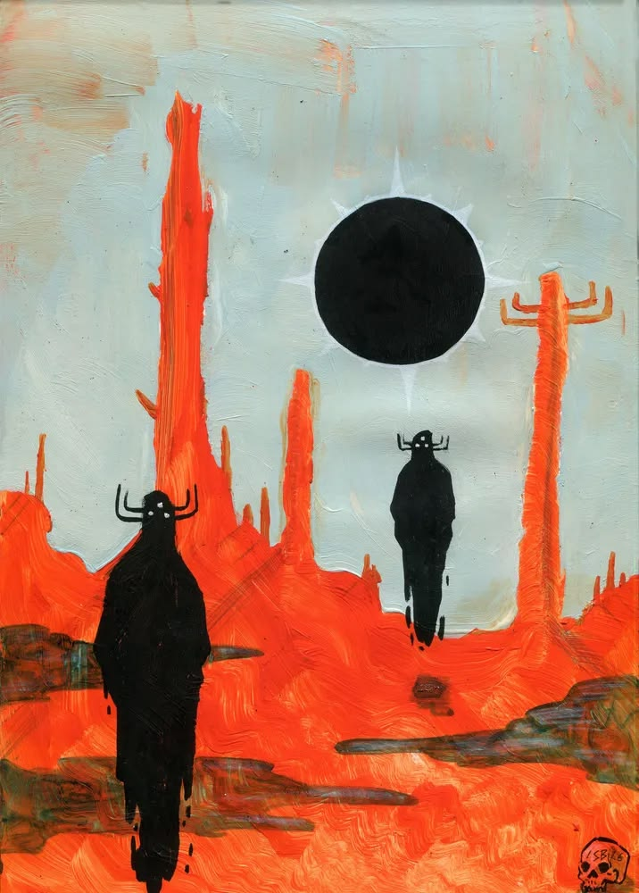
- **What's there:** a flat vermilion desert under a pale grey-green sky with a black eclipsed sun. Thin red rock spires and two tall black horned figures.
- **Habitat:** an old, dry, burnt world. Almost no producers are visible. The figures are hardened survivors or hunters walking a dead plain.
- **Colours:** field `#B7C8BF` pale sage (21%) + `#B3BCAF`. Fire `#F85C28` vermilion (27%) and `#7D2A16` dried blood. Black is the only accent. **Two-tone extreme.**
- **How it came about:**
  1. Lots of silicon met lots of oxygen and rusted to stone (R2).
  2. Ages in an iron-rich water sea stained that stone red (R3).
  3. Heat kept life few, dark and armoured (R6).
  4. Hunger made what's left horned (R10).
  5. The spires are old builder colonies, long abandoned (R12).

### eco-02 · Violet Sun Hollow
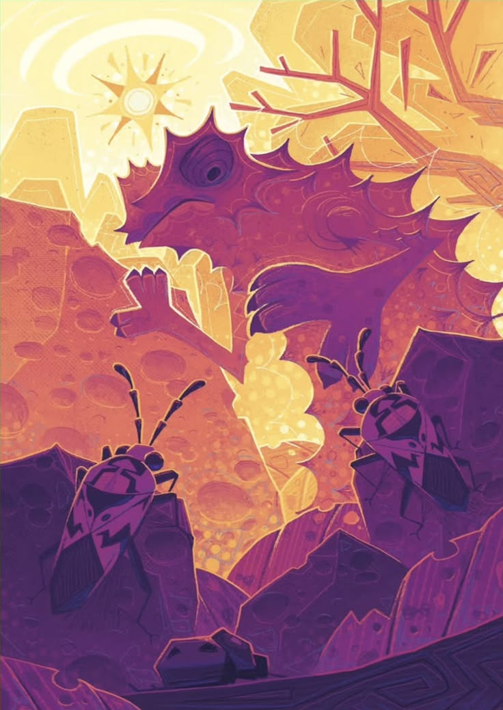
- **What's there:** a violet spiky-backed lizard climbing cratered rock under a blazing gold sun. Two patterned beetles in the foreground and a branching crystal tree.
- **Habitat:** a sunlit rocky hollow. Beetles graze the rock and the lizard hunts them: a three-step food chain in one frame.
- **Colours:** field `#F0C678` gold + `#FAF0B8` lemon (27%). Fire `#492A5F` deep violet (24%), `#753475` plum, `#A34171` magenta, and `#D07569` warm coral bridging the two.
- **How it came about:**
  1. Gold-lemon light is an acid sea (R4).
  2. Acid is where silicon thrives (R5).
  3. Violet creatures are silicon + oxygen life (R9).
  4. Their dorsal spikes and the tree's straight branching are stiff silicon bones (R1).
  5. Cratered rock is porous stone left by builders (R12).
  6. Bright light means busy grazers (R7), and grazers mean a hunter (R10).

### eco-03 · Sindha: Pillars in the Teal Sea
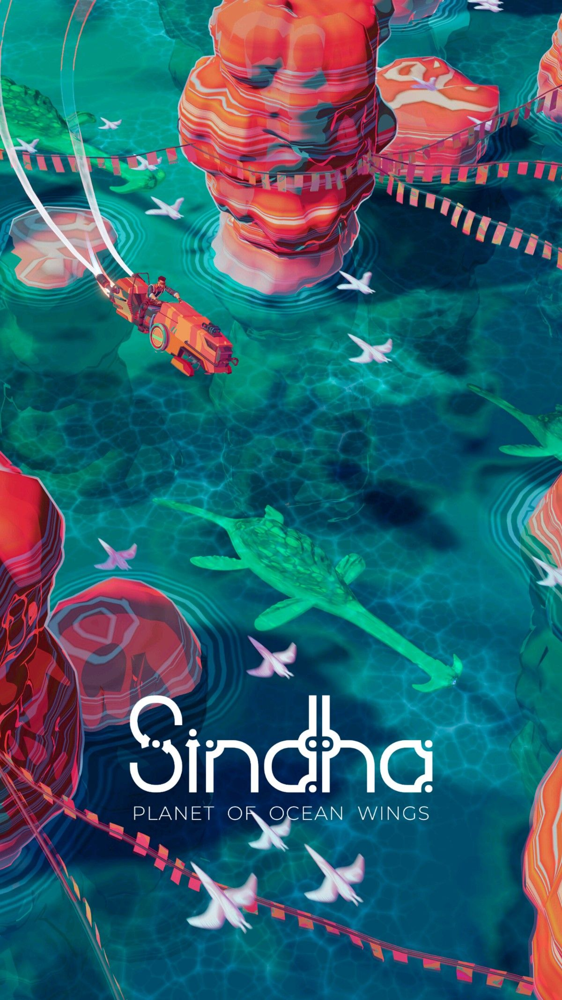
- **What's there:** a top-down view of a teal sea with stacked coral-red pillars. Pale bird-like fliers and a swimming lizard thread between them.
- **Habitat:** a warm, shallow, living sea. The pillars are colonies, and the fliers move between them like pollinators.
- **Colours:** field `#01435C` deep teal (27%), `#276871`, `#348482`, `#4FADA2`. Fire: the coral-red pillars, plus `#5A3B52` plum shadow. **Coral on teal**, our Water + Carbon default.
- **How it came about:**
  1. A water sea paints teal (R4) and favours carbon (R5).
  2. Carbon life stacks soft, rounded layers instead of stone, so its towers are living tissue (R1, R2).
  3. Warmth and good light give a gentle, crowded ecosystem.
  4. With no fierce hunters, the fliers just drift (R11).

### eco-04 · Frost Arches
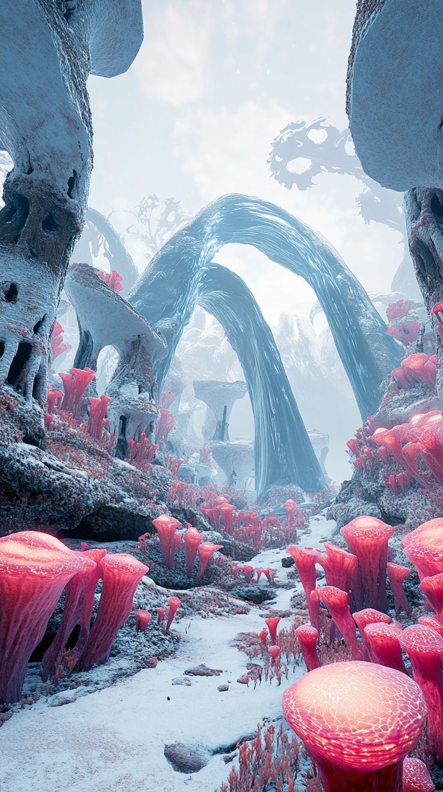
- **What's there:** a snowy canyon spanned by smooth pale arches, with porous stone walls. The floor is carpeted in glowing hot-pink cup flora.
- **Habitat:** a cold, still, low-light valley. Stone builders shaped it long ago, and glowing producers now live in its shelter.
- **Colours:** field `#D3DEE8` + `#EAEFF3` frost, `#A7B8CC`, `#587C9A` cold blue. Fire: saturated pink glow, with `#5F415E` plum shadows. **Pale field + one hot glow.**
- **How it came about:**
  1. A methane sea gives frost (R4) and spares silicon (R5).
  2. Silicon builders raised arches that never dissolve (R2, R12).
  3. Cold made everything slow and tall (R6).
  4. Low light made the flora glow instead of spreading caps (R8).
  5. They glow pink because they're oxygen-rich life (R9).

### eco-05 · Parasol Giants
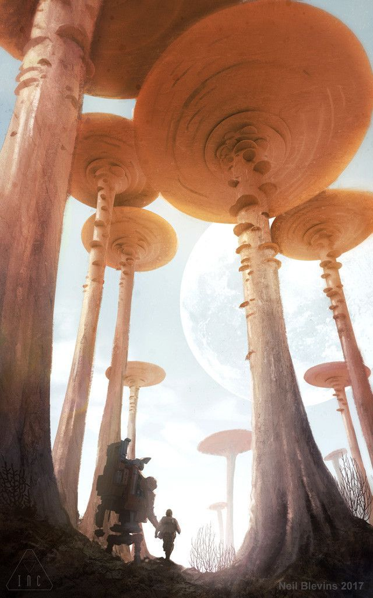
- **What's there:** colossal parasol fungi with gills and ringed stalks, backlit by a hazy sky and a huge pale moon. A tiny mech and pilot sit at their feet.
- **Habitat:** a giant, slow forest. The caps are the producers, and the scale makes the visitor feel like an insect.
- **Colours:** field `#E5EAE8` + `#F8FCFD` haze (29%). Fire `#AD603B` burnt orange (20%), `#875641`, `#C2977D` tan, `#4C2F21` stalk brown.
- **How it came about:**
  1. A methane sea lit by the sun builds an orange smog (tholin) that stains everything amber-brown (R3).
  2. Cold made life slow, long-lived and gigantic (R6).
  3. Plentiful light made the giants spread caps (R7).
  4. The gills and soft rings are carbon curves (R1). It's carbon life thriving in the cold, slowly.

### eco-06 · Voyagers of Nera: Capped Sea Stacks
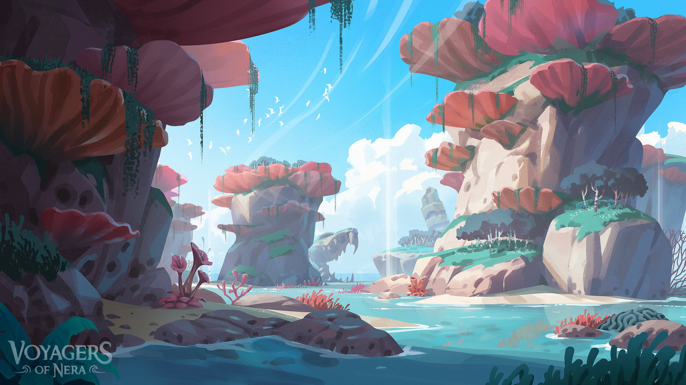
- **What's there:** bright sea stacks of pale stone topped with coral-pink shelf caps, a turquoise lagoon, and distant waterfalls.
- **Habitat:** a coastal reef world. Stone holds the ground, and living caps colonise the tops where the light is.
- **Colours:** field `#283744` + `#8A919B` + `#D5E5E9` (stone and sky). Fire `#72D2F2` turquoise water (14%) and the coral caps, with `#533A47` plum shade.
- **How it came about:**
  1. A carbon + silicon recipe splits the work: silicon rusts into stone stacks (R2, R12) and carbon life rides on top (R9).
  2. A water sea keeps the silicon as rock, not life (R5).
  3. Bright light gives the shelf caps (R7).
  4. A mild climate keeps everything mid-sized (R6).

### eco-07 · Two Suns over the Spire
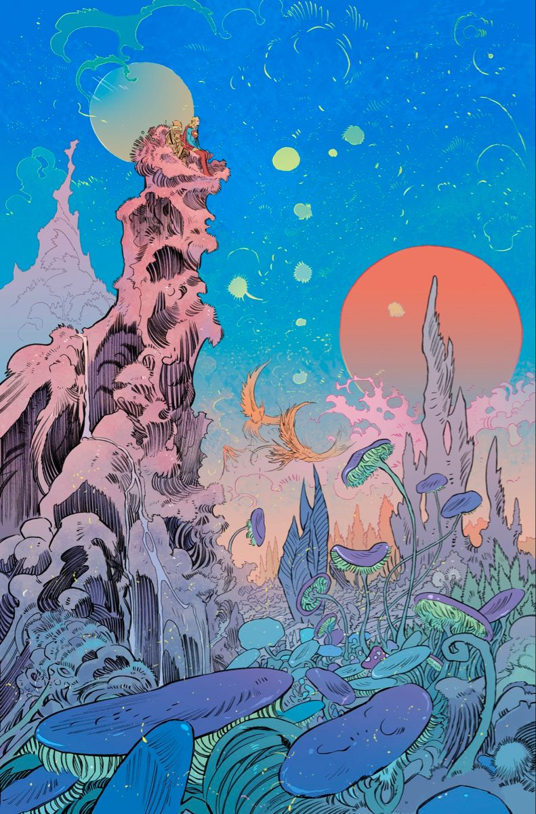
- **What's there:** a towering pink fluted spire with travellers on top, two suns (pale green and coral), floating spores, and orange phoenix-like fliers. Violet and teal parasol mushrooms fill the foreground.
- **Habitat:** **peak variety.** Producers, fliers, drifting spores and big colonies all coexist. It's the busiest, most balanced world on the board.
- **Colours:** field `#017DDD` + `#2096C5` sky blue (38%). Fire: pink spire, coral sun, `#B7A9B1` and `#AD909D` lilac, violet caps, orange fliers. **The most colours of any pin**, because life is everywhere (R9).
- **How it came about:**
  1. A balanced recipe in the Goldilocks band of heat and light gives the most kinds of life (DESIGN §1).
  2. The spire is an old colony, its stone stained pink by oxygen-rich life living in it (R3, R12).
  3. Two suns mean lots of light, so lots of caps (R7).
  4. Thick air carries spores and fliers (R11).

### eco-08 · Coral Forest at Two Moons
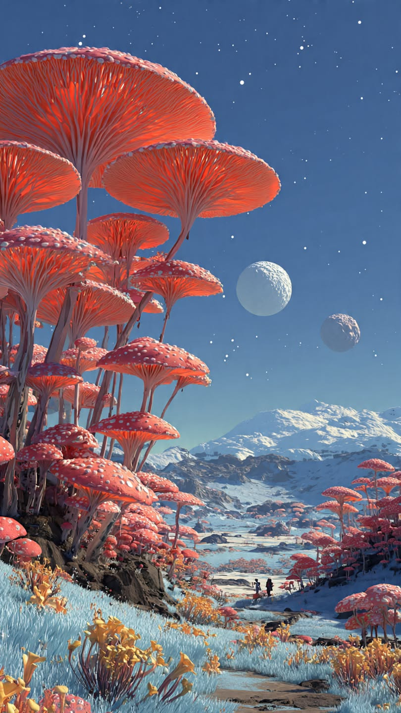
- **What's there:** a dense forest of coral-red spotted parasol trees on frosted ground, under a deep blue night with two moons and snowy hills. Two tiny walkers.
- **Habitat:** a cold, slow forest at night. The caps are producers, still and long-lived.
- **Colours:** field `#4A6D9A` night blue (29%), `#414E6B`, frost `#9FADB3`. Fire `#994844` coral-red (25%). **Coral vs night vs frost.**
- **How it came about:**
  1. Carbon life (R9) in a methane cold (R4): carbon can survive here, just slowly, so it grows huge and old (R6).
  2. Enough light for caps (R7).
  3. The cap spots are flecks of stone the trees carry, as armour against the cold (R2).

### eco-09 · The Violet Hunter
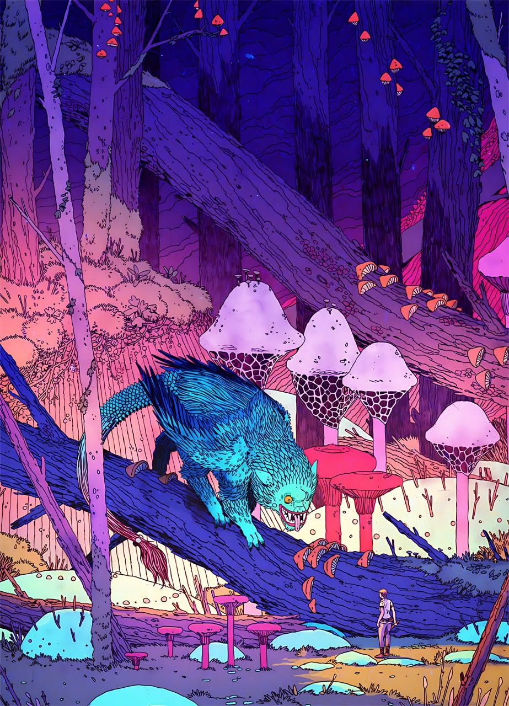
- **What's there:** a deep violet forest of tall straight trunks. A cyan feathered beast prowls along a fallen log, past lilac honeycomb-capped mushrooms, while a tiny explorer watches.
- **Habitat:** a dim, dense forest with a clear predator. Mushrooms are the producers and the beast is the top of the chain.
- **Colours:** field `#3D2285` + `#1E0D68` violet (46%), `#6F2678`. Fire: the cyan beast, `#AB7D9E` lilac caps, pink accents. **Cyan on violet.**
- **How it came about:**
  1. An ammonia sea paints violet dusk (R4).
  2. The beast is silicon life (cyan, R9), and its feathers are stiff rods (R1).
  3. Honeycomb caps are porous stone grown by builders (R12).
  4. Dim light, and a hungry world, make a hunter (R10).
  5. The straight vertical trunks are silicon bones too (R1).

### eco-10 · Red Canyon Parasol
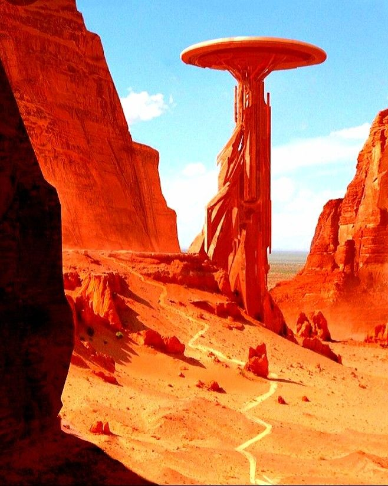
- **What's there:** a blazing red-orange canyon under a clean sky-blue sky, with one tall parasol tower in the middle.
- **Habitat:** an almost lifeless, very old world. A single survivor colony holds the canyon.
- **Colours:** field `#8FDBFD` sky (14%) + `#E0F4EB`. Fire `#C61807` red (23%), `#F69A43` orange (25%), `#E94814`, and `#600804` deep rust. **One mono-hue world + one sky blue.**
- **How it came about:**
  1. Like eco-01, ages of silicon stone stained by an iron-rich sea (R2, R3), but here it's hot (R6).
  2. Most life burned out.
  3. The parasol tower is the last builder colony (R12), spreading a cap to catch the harsh light (R7).

### eco-11 · Shoal through the Kelp Forest
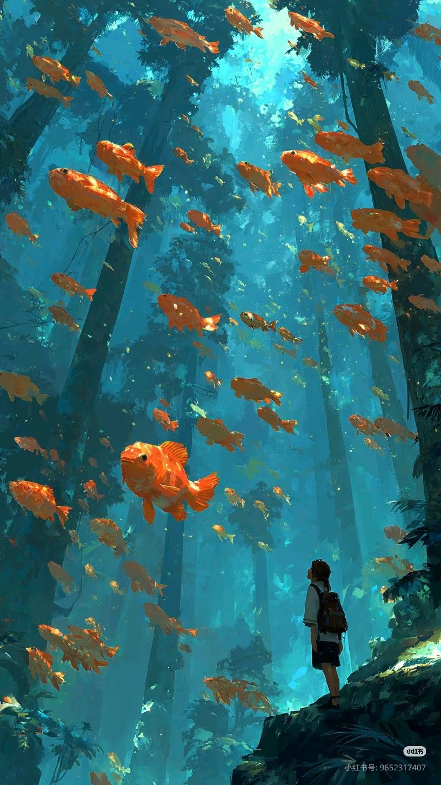
- **What's there:** a teal forest of tall trunks, with a shoal of orange fish swimming through the air between them and a lone figure on a rock.
- **Habitat:** a living mid-water forest. The trunks are producers and the fish are grazers moving in shoals.
- **Colours:** field `#103D45` + `#1F7689` + `#308A98` teal (68%), `#44AEB7` haze. Fire: the orange fish. **Orange on teal**, a near-exact match to our Water sea.
- **How it came about:**
  1. A water sea (R4) with carbon life (R9).
  2. Fish shoal because a medium hunger makes grouping safer than drifting alone (R10).
  3. Air thick enough to swim through (R11).
  4. Filtered light gives tall trunks rather than caps (R7, weakened).

### eco-12 · Glow Garden
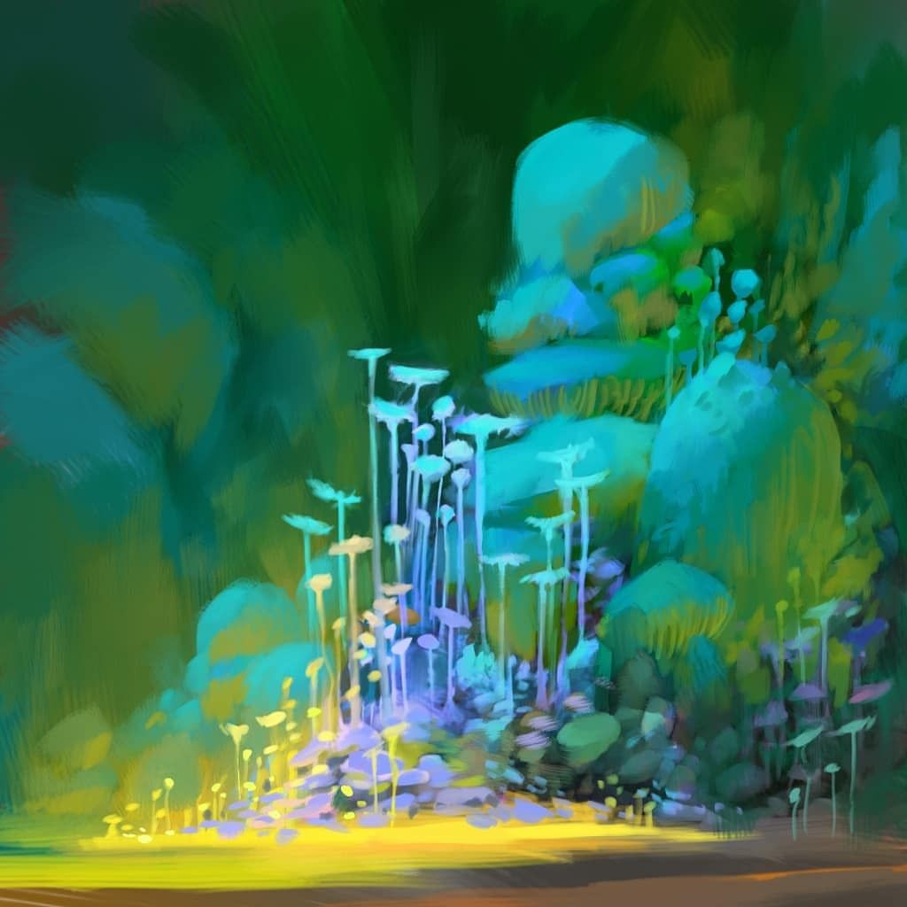
- **What's there:** a painterly cluster of pale glowing stalk-flora with small caps, rising out of a yellow-lit floor in a deep green haze.
- **Habitat:** a dark, sheltered grove. The glowing stalks are producers making their own light.
- **Colours:** field `#094924` + `#345F3F` + `#317652` deep green (66%). Fire `#27AAA6` teal glow and `#ABB66B` yellow-olive floor light.
- **How it came about:**
  1. A water sea in **very dim light**: the teal field mixes with amber Spark glow into green (R4 + R8).
  2. Producers can't spread caps in the dark, so they glow and cluster instead (R8).
  3. The pale cyan stalks are silicon-leaning life (R9).
  4. Note: **green is the one field none of our four seas makes on its own.** It's water + dim light + lots of glow.

### eco-13 · The Living Arch
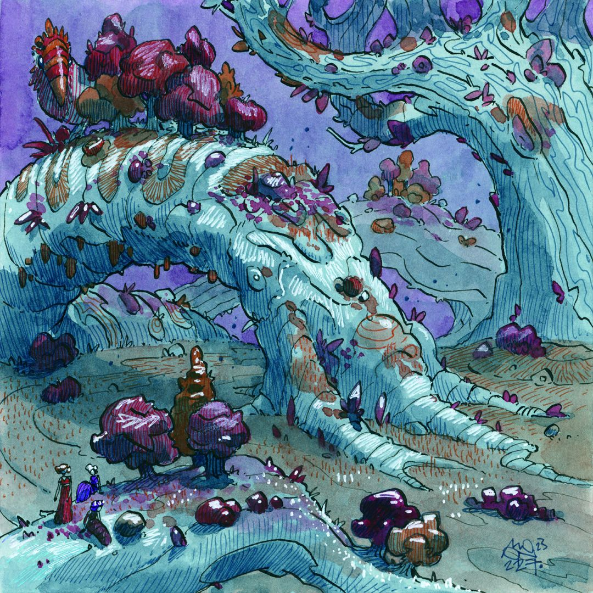
- **What's there:** a vast pale-cyan arched tree-creature, its bark streaked with rust-orange rings and studded with violet crystals. Plum and maroon shrubs sit on its back and around its feet, a hornbill-like bird perches on top, and tiny figures stand below.
- **Habitat:** **a creature that is a landscape.** The arch is alive and the shrubs live on it, so it's a whole ecosystem on one body.
- **Colours:** field `#343B53` dusk, plus a violet sky. Fire `#76A7B1`, `#94CDD0` pale cyan, `#336B7F`, plum and maroon shrubs, rust-orange rings.
- **How it came about:**
  1. An ammonia sea gives the violet sky (R4).
  2. The arch is a silicon builder grown so old and cold-slow that it became terrain (R6, R12). Its rigid limbs are straight silicon bones bent into an arch over centuries (R1).
  3. Rust rings are stain bands, one per age (R3), like tree rings.
  4. Violet crystals are silicon + oxygen buds (R9).
  5. Plum shrubs are oxygen-rich life living on it.

### eco-14 · Bone Reef
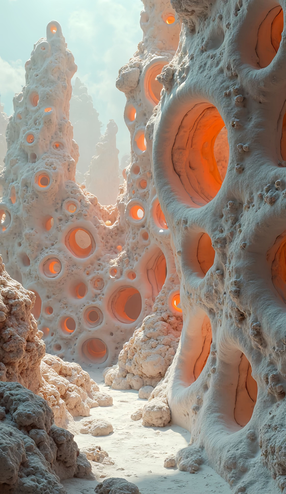
- **What's there:** bone-white porous spires, pitted like sponge or coral, with glowing orange interiors in the deepest pores. A narrow pale path runs through them.
- **Habitat:** **a silicon city.** The spires are built, the pores are homes, and the glow means someone is inside.
- **Colours:** field `#5F5954` + `#8C9490` + `#BAB7AC` stone greys, `#DAE8DF` pale haze. Fire `#9B6E59` and the orange pore-glow. **Glow seated in shadow** (ART_DIRECTION rule 3).
- **How it came about:**
  1. A silicon + oxygen heavy recipe in an acid sea, silicon's best world (R5).
  2. Builders rusted their own homes into stone (R2, R12).
  3. Dim light made the inhabitants glow (R8).
  4. The diatom and radiolarian look is real: glass-shelled life builds exactly these pores (R12 [sci]).

### eco-15 · Lantern River
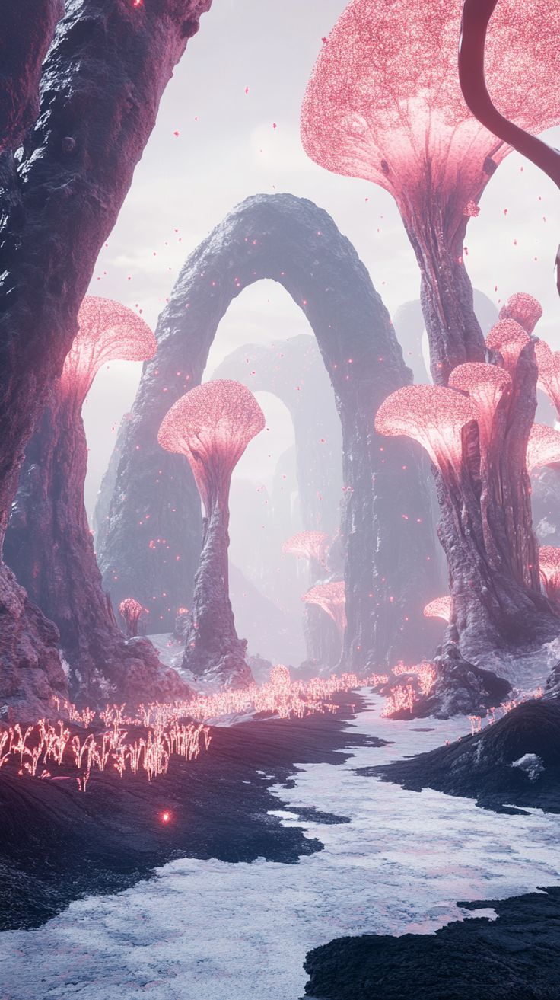
- **What's there:** dark stone arches over a white river, lined with pink glittering parasol flora and tiny pink sparks drifting in mist.
- **Habitat:** a cold river valley. Producers line the banks and glow.
- **Colours:** field `#403752` dusk plum, `#9E9FB9`, `#EAE5E9` white river. Fire `#D5A7B9` pink and `#927592` mauve.
- **How it came about:**
  1. A methane sea: the white river is liquid methane. Titan has real methane rivers [sci] (R4).
  2. Dark arches are very old stone, stained dark (R3, R12).
  3. Dim light makes the flora glow pink, so it's oxygen-rich life (R8, R9).
  4. Cold keeps it still and tall (R6).

---

## 3. Fauna

| Pin | What it is | How it could come about |
|---|---|---|
| **fauna-01** Watercolour giants | Tall pale-blue striders with orange dot-eye clusters, and a tiny explorer | Silicon (pale cyan) in the cold grows huge and thin (R6). Stiff straight limbs (R1). Dot-eyes glow because silicon sees by light (ART_DIRECTION §5). |
| **fauna-02** Rhino-lizards ×3 | One horned, plated body in three colourways | Silicon in a water world must armour itself, hence the plates (R5). Three colourways = mutation drift on copy (DESIGN §4). |
| **fauna-03** Jellybots | Translucent cyan-to-lilac bell with trailing tendrils | A silicon drifter in thick air (R11): glassy and light, with rods trailing as tendrils (R1). Lilac edge = some oxygen (R9). |
| **fauna-04** Seafloor specimen poster | A labelled plate of seafloor creatures, with Latin names | Not a world but our **field-guide format** (ART_DIRECTION §6) |
| **fauna-05** Frilled serpent | Banded claws, orange fin frills, swimming | A **hunter** (R10). Its banding is alternating carbon and silicon atoms down the chain (R9). Frills are flexible carbon edges (R1). |
| **fauna-06** Plated hopper | A plated body with one big glossy eye | A **grazer** in a hungry world: plates against hunters (R10), plus the big-eye charm |
| **fauna-07** Hammerhead strider | Flat ochre and slate, extremely tall and thin | Cold makes it tall (R6). Ochre is acid-stained stone armour (R3). |
| **fauna-08** Confetti eels | Patchwork multicolour scales, black heads, white ring eyes | A **mixed recipe** (R9): every atom keeps its own family's colour. Long, sinuous carbon bodies (R1). |
| **fauna-09** Sky whales | Whales hanging in the sky over a beach, girl and dog | Thick air is a sea (R11). Cold-slow giants (R6). Smooth curves are carbon (R1). |

## 4. Flora

**flora-01**, four tree types, and the four rules that make them:

| Tree | Rule |
|---|---|
| **Swirl tree** (curled trunk, flame canopy) | Carbon curls (R1) |
| **Bonsai umbrella** (flat canopy on a bent stalk) | Bright light makes caps (R7) |
| **Stacked domes** (tiers of round domes) | Silicon stacks repeating units, a geometric rhythm (R1) |
| **Mushroom canopy** (soft, wide, layered) | Cold + light: slow giant caps (R6, R7) |

---

## 5. Working backwards: the controls

### 5.1 What actually varies across the board

Tallying the causes used in §2–4 shows which ones explain the most pins:

| Cause | Rules | Pins it explains | Becomes |
|---|---|---|---|
| Which elements life is made of | R1, R2, R9, R12 | **25 / 25** | **Recipe** |
| What the world's liquid is | R3, R4, R5 | 15 / 15 ecosystems | **Sea** |
| How cold or hot | R6 | 18 | **Heat** |
| How much light | R7, R8 | 16 | **Light** |
| How fierce the competition | R10 | 9 | **Hunger** |
| How old the world is | R3, R12 | 10 | **Time** (a clock, not a dial) |
| Thick air | R11 | 6 | No control: always on (ART_DIRECTION: "air is a sea") |
| Gravity, atmosphere gases, planet size | — | 0 needed | **Cut** |

### 5.2 The five controls (+ the clock)

Each control is **one gesture**, **no numbers**, and the first effect can be guessed.

| Control | Gesture | You'd predict… | …but then |
|---|---|---|---|
| **Recipe** | Drag one dot inside a triangle with **Carbon · Silicon · Oxygen** at the corners | Towards **Si**: sharper, glassier, cyan. Towards **C**: softer, curvier, coral. Towards **O**: more magenta, more stone or gas. | Too much O and your silicon **rusts into reefs**, which turn into homes for the next generation. Mixed recipes give patchwork creatures you didn't design. |
| **Sea** | Pick 1 of 4 swatches: **Water · Ammonia · Methane · Acid** | The sky changes colour | The sea **decides who survives**: water dissolves silicon, methane spares it but slows it, acid makes it thrive. Old stone **stains** the sea's colour (red, orange, yellow, plum). |
| **Heat** | Slider ❄ ↔ 🔥 | Cold freezes, hot melts | The **middle** is where life explodes. Cold makes **giants**, hot makes **small, tough, dark** life. |
| **Light** | Slider 🌑 ↔ ☀ | More light, more life | Bright worlds grow **caps and canopies**. Dark worlds **glow**, and glow in the dark attracts hunters. |
| **Hunger** | Slider 🕊 ↔ 🦷 | Fiercer means more fighting | Prey grow **plates**, hunters grow **horns, frills and big eyes**. Moderate hunger makes **shoals**. |
| **Time** | ▶ / ⏩ (fast-forward) | Things happen faster | Fast-forward is how you see **stains, reefs and living arches**, the slow wonders of old worlds |

**Why a triangle:** it replaces 4 families × 4 dials (DESIGN §2) with one drag. "More silicon" is a direction you can *see*. The per-atom dials still exist as hidden presets driven by the recipe (Hands, Grip and Rust come from each family's science values). For experts, they move to an optional **Lab drawer** (§6).

**Spark** has no control of its own. It rains in with **Light**.

### 5.3 Proof: every world on the board is reachable

| Pin | Recipe (C · Si · O) | Sea | Heat | Light | Hunger | Time |
|---|---|---|---|---|---|---|
| eco-01 Vermilion Eclipse | Si+O heavy | Water | Hot | Bright | Fierce | Old |
| eco-02 Violet Sun Hollow | Si+O | Acid | Warm | Bright | Medium | Mid |
| eco-03 Sindha pillars | C heavy | Water | Mild | Bright | Gentle | Mid |
| eco-04 Frost Arches | Si+O, O-rich life | Methane | Cold | Dim | Gentle | Old |
| eco-05 Parasol Giants | C heavy | Methane | Cold | Bright (hazy) | Gentle | Old |
| eco-06 Capped Sea Stacks | C+Si balanced | Water | Mild | Bright | Gentle | Mid |
| eco-07 Two Suns Spire | **Balanced** (centre) | Water | Mild | Bright | Low | Old |
| eco-08 Coral Forest | C heavy | Methane | Cold | Medium | Gentle | Old |
| eco-09 Violet Hunter | Si heavy + O | Ammonia | Cool | Dim | **Fierce** | Mid |
| eco-10 Red Canyon | Si+O heavy | Water | **Hot** | Bright | Low | **Very old** |
| eco-11 Kelp Shoal | C heavy | Water | Mild | Medium | Medium | Mid |
| eco-12 Glow Garden | Si leaning | Water | Mild | **Very dim** | Gentle | Mid |
| eco-13 Living Arch | Si heavy + O | Ammonia | Cool | Medium | Gentle | **Very old** |
| eco-14 Bone Reef | Si+O heavy | **Acid** | Warm | Dim | Low | Old |
| eco-15 Lantern River | O-rich + Si | Methane | Cold | Dim | Gentle | Old |
| fauna-01 Giants | Si heavy | Methane | Cold | Medium | Gentle | — |
| fauna-02 Rhino-lizards | Si heavy | Water | Mild | Medium | Medium | — |
| fauna-05 Frilled serpent | C+Si alternating | Water | Mild | Medium | Fierce | — |
| fauna-08 Confetti eels | Balanced mix | any | Mild | Medium | Medium | — |
| fauna-09 Sky whales | C heavy | Methane | Cold | Bright | Gentle | — |

Every pin is reachable with **five dials and a clock**. A few patterns jump out, and they're good presets to ship:

| Preset | Settings | Looks like |
|---|---|---|
| **"Earth-ish"** | C · Water · Mild · Bright | eco-03, eco-11 |
| **"Silicon city"** | Si+O · Acid · Warm · Dim | eco-14, eco-02 |
| **"Frozen cathedral"** | Si+O · Methane · Cold · Dim | eco-04, eco-15 |
| **"Dead red"** | Si+O · Water · Hot · Old | eco-01, eco-10 (the warning world) |
| **"Hunter's dusk"** | Si · Ammonia · Cool · Dim · Fierce | eco-09 |

### 5.4 The "make silicon life" goal with these controls

The DESIGN.md goal still works, and it's simpler:

1. **Drag Recipe towards Si** in the default Water sea. Silicon chains form, then **dissolve** (R5). The obvious guess, "even more silicon", doesn't help.
2. **Change Sea.** In Methane silicon survives but barely moves (R6). In **Acid** it starts to thrive.
3. **Too much oxygen** and silicon rusts into stone (R2). Pull the dot off the O corner, *or* keep some and discover that **reefs become homes** (R12).
4. **Find the middle** of Heat and Light: the first silicon copier appears, and the discovery shot plays (ART_DIRECTION §6).

---

## 6. Changes to other docs

| Doc | Change | Status |
|---|---|---|
| `DESIGN.md` §2 | Player-facing controls become **Recipe · Sea · Heat · Light · Hunger + Time**. Hands, Grip and Rust per family become hidden presets driven by Recipe, with an optional **Lab drawer** for experts. Pull becomes **Hunger** (one global "how lopsided are the chases"). | **Proposed**. A note has been added to DESIGN.md. |
| `ART_DIRECTION.md` §3–4 | **Stone stains with age** (R3): fresh stone is bone `#ECE4D6`, then lerps over time towards the sea's stain colour: Water rust `#C61807`-ish, Methane tholin orange `#AD603B`, Acid sulfur `#E2CF95`, Ammonia plum `#5A3B52`. Family colours still never change; only dead stone stains. | **Proposed**. Needs an art-direction owner's OK. |
| `ART_DIRECTION.md` §3 | **Green fields** (eco-12) come from Water + very dim Light + heavy glow, not a fifth sea | Note only |
| `world-style` | The stain needs one extra uniform (`stoneAge`) on the shared world material. No new material. | Proposed |

**Open question:** do we need a separate **Hunger** dial, or can it come from Light? (Scarce light → competition → hunters, DESIGN §2.) Merging them gives **4 dials + clock**, which is simpler, but the player loses the "gentle world in the dark" combination (eco-12, eco-15). Our leaning: keep Hunger, and test with a fresh player at H8.
